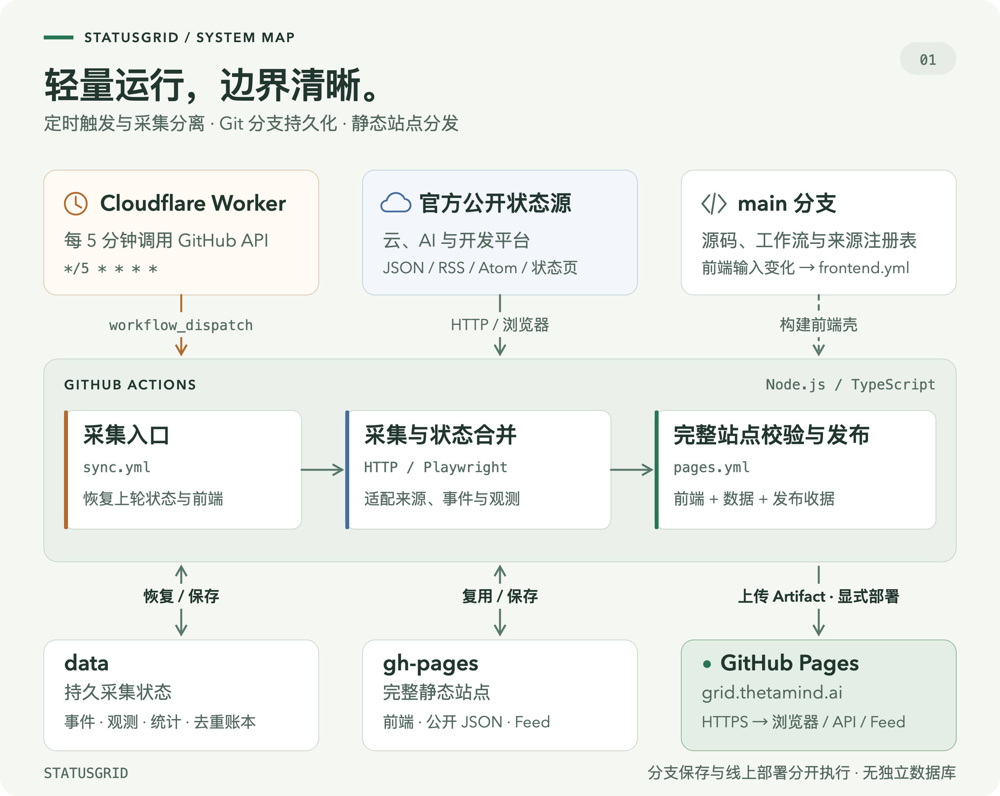
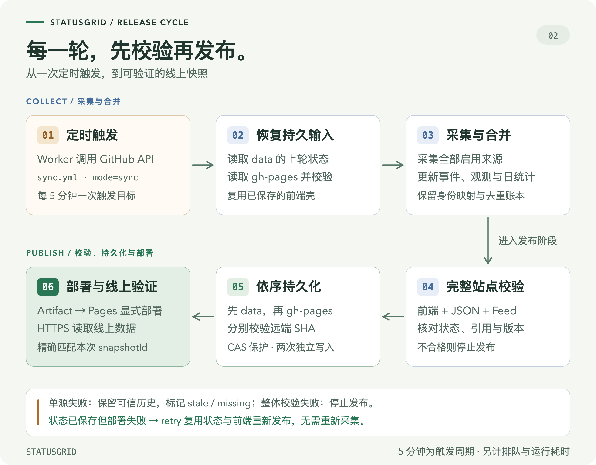
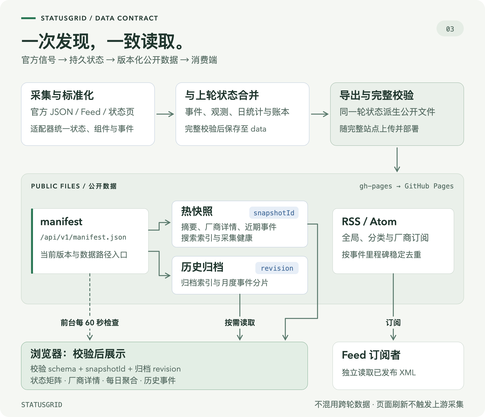

# StatusGrid

面向 SRE 和架构师的免费基础设施状态看板，聚合 20 家云、AI 与开发平台的官方公开状态。

在线使用：**[grid.thetamind.ai](https://grid.thetamind.ai/)**

支持状态矩阵、组件／地域搜索、厂商详情、30 日轨迹与每日聚合、历史事件，以及 JSON / RSS / Atom。采集失败或历史缺失会明确标识；采样统计不代表厂商 SLA。国内来源范围为 AWS 中国北京／宁夏、腾讯云北京／上海、阿里云上海、百度云北京／上海。

## 架构与流程

### 整体架构

采集在 GitHub Actions 中执行，浏览器读取 GitHub Pages 上的静态文件。Cloudflare Worker 负责定时调用 GitHub API，不承载网页或存储采集数据。



`main` 推送后会检查前端输入指纹，有变化才重新构建；日常定时采集复用 `gh-pages` 中的前端。Worker 单独部署，GitHub 原生采集 Cron 已关闭。写入 `gh-pages` 与部署 Pages 是两个步骤。

### 每轮采集与发布



单个来源失败会保留上次可信结果，并标记 `stale`；从未成功的来源标记 `missing`。这类结果可以随其他来源一起发布；状态损坏或整体校验失败则停止发布。

`data`、`gh-pages` 和 Pages 部署分别执行，不构成同一事务。若状态已保存但部署失败，使用 `retry` 读取已保存状态和前端重新发布，无需重新采集；操作见 [部署文档](docs/deployment.md)。5 分钟是触发周期，实际发布还受排队与运行耗时影响。

### 数据流转与一致读取



暂存状态完整校验通过后才保存至 `data`。浏览器先读 manifest，再沿其中的版本化路径加载数据，校验 schema、快照 ID 与归档 revision，避免把不同轮次的摘要、详情和历史混在一起。页面刷新只读取已发布文件，不触发上游采集。

观测与日统计按 UTC 滚动保留 90 天，事件按月持续归档；公开快照至少保留最近 12 份及最近 60 分钟内全部版本。路径与保留规则详见 [公共 API](docs/api.md) 和 [运行手册](docs/runbook.md)。

图示的 [SVG 源文件与图片导出方式](docs/diagrams/README.md) 随仓库维护。

## 本地运行

推荐 Node 24，也支持 Node 22.12 及以上的 22.x。

```sh
npm ci
npx playwright install chromium
npm run collect -- --state-dir .statusgrid/state --output-dir public --report .statusgrid/run.json
npm run dev -- --port 5174
```

打开 `http://127.0.0.1:5174`。Linux 安装浏览器时使用 `npx playwright install --with-deps chromium`。可通过 `STATUSGRID_BROWSER_EXECUTABLE` 指定已有浏览器。

`collect` 每次只采集一轮；本地持续采集见 [运行手册](docs/runbook.md)。页面刷新和 Vite 不会触发上游采集。`npm run preview:fixture` 可启动带演示标识的预览，供开发及浏览器测试使用。

## 自动更新

- Cloudflare Worker 使用 `*/5 * * * *`，每 5 分钟通过 API 触发 GitHub Actions 采集；GitHub 原生采集 Cron 已关闭。
- Worker 需要单独部署并配置 GitHub 令牌；只推送本仓库不会启动定时采集。完整后台操作见 [部署文档](docs/deployment.md#cloudflare-每-5-分钟触发采集)。
- 每轮读取持久状态，采集全部来源，校验并保存数据，再发布 Pages；定时采集复用已构建的前端。
- 页面在前台每 60 秒检查新快照。没有更新时，5 分钟配置下在 10／15 分钟分别提示延迟／过期。
- 独立的 Back up collected status 工作流每天 UTC 00:17（上海时间 08:17）备份状态，Artifact 保留 30 天。

5 分钟是触发目标，实际数据发布时间还包括 Actions 排队与运行耗时。Cloudflare 自动触发在 GitHub 中显示为 `workflow_dispatch`，运行名称带 `Cloudflare` 和计划时间；需同时检查 Worker 的定时日志及线上快照时间持续推进，不能只看手动成功或 Git 提交时间。

## 数据存储

使用 GitHub 分支和静态 JSON 文件持久化，无独立数据库：

| 位置 | 内容 |
| --- | --- |
| `main` | 源码、工作流、注册表和必要测试 |
| `data` | 采集状态、事件、观测记录、日统计和通知去重账本 |
| `gh-pages` | 完整前端、公开 API 和 Feed；由 Actions 上传至 Pages |
| 本地 `.statusgrid/state` | 本机采集状态，Git 忽略 |
| Actions Artifact | 每日状态备份，保留 30 天 |

Runner 的临时目录用于处理当次任务；下一轮从 `data` 恢复状态。观测与日统计保留滚动 90 天，事件按月持续归档，因此总存储会随历史增长。存储布局、保留策略与恢复步骤见 [运行手册](docs/runbook.md)。

## 开发

```sh
npm run typecheck
npm run lint
npm run test:unit
npm run build
npm run test:e2e
```

- [运行、诊断、备份和恢复](docs/runbook.md)
- [GitHub Actions / Pages 部署](docs/deployment.md)
- [公共 API、版本与 Feed](docs/api.md)
- [新增来源](docs/adding-providers.md)

历史设计、开发计划和旧验收材料保存在 `codex/archive-before-cleanup-20261127` 分支。
