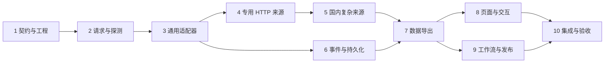

# StatusGrid MVP Implementation Plan

> **For agentic workers:** Use `superpowers:executing-plans` for inline execution, or `superpowers:subagent-driven-development` when delegation is explicitly selected. Follow tasks in order and keep the review gates.

**Goal:** 为资深 SRE 与架构师实现覆盖 13 家云与 AI 厂商、目标每 5 分钟更新、具备历史事件和开放数据能力的免费 StatusGrid。

**Architecture:** Node.js 采集器按厂商隔离采集，统一状态与事件后持久化并导出静态 JSON / RSS / Atom。React 前端读取同一快照版本的数据，GitHub Actions 与显式 Pages 部署完成发布。前端构建与定时采集分离。

**Tech Stack:** Node.js >=22.12.0、TypeScript strict、React、Vite、Zod、XML 解析器、按需 Playwright、Vitest、Testing Library、GitHub Actions / Pages。

**Spec:** [总体设计](../specs/2026-11-25-statusgrid-design.md)、[数据契约](../specs/2026-11-25-statusgrid-data-contracts.md)、[数据源验证记录](../specs/2026-11-25-statusgrid-source-validation.md)。

## 当前状态与执行边界

- 用户已于 2026-11-25 确认设计与计划，并要求开始编码；最初推进 Task 1～3，随后明确要求“全部写完再停”，现继续执行全部本地代码、测试和文档任务。
- 计划中的命令是各阶段执行指令，不表示全部已运行或已通过；实际完成项与验证结果在阶段完成时更新。
- 实施时先检查工作区，保留用户已有的 `spec/` 文件与所有无关更改，使用 `codex/statusgrid-mvp` 开发分支。
- 不在本阶段自动创建远端分支、推送、部署、修改 DNS、配置云账号或发送消息。
- 本地功能验证可自主执行；正式部署涉及的仓库权限和外部配置在交付时单独列明。
- 实现按下面各任务产出测试与代码；每项交付均先出现可解释的失败测试，再实现并确认通过。纯配置、样式和人类文档不增加机械化测试。
- 每个里程碑形成可审阅差异。需要提交时只包含本次工作文件，不自动把用户现有未跟踪文件纳入提交。

## Global Constraints

- 使用对象：用户本人及同类资深 SRE、架构师。
- 默认采集周期：5 分钟；配置支持 10 分钟。
- 完整 MVP 覆盖：原始清单中的 13 家厂商。
- 未接通、解析失败、覆盖不足和数据过期均不得显示为正常。
- 首屏 `summary.json` Gzip 后不超过 40 KiB。
- 服务状态与采集健康度分别存储；官方时间与观测时间分别标注。
- 历史无数据不补绿；采集失败不生成 / 恢复服务故障。
- 开发预览可以分批接入；完整 MVP 不以页面存在或模拟数据代替接入验收。
- 任何含 `dataMode=fixture` 的产物不得部署到正式域名。
- 统一注册表为 `registry/providers.json`，通用协议适配器名称统一为 `statuspage-v2`。

## 里程碑与依赖



| 里程碑 | 包含任务 | 可审阅结果 | 退出门槛 |
| --- | --- | --- | --- |
| M0 设计确定 | 本轮文档 | 架构、契约、接入风险、开发顺序 | 用户评审需求与设计决策 |
| M1 真实采集基础 | 1～3 | 5 家通用厂商的本地真实采集与失败隔离 | fixture 回放通过；结构与语义有证据 |
| M2 完整数据链 | 4～7 | 13 家适配、历史状态、JSON 与 Feed | 每家 G0～G2 通过；幂等和历史边界通过 |
| M3 可操作产品 | 8 | 桌面 / 移动端矩阵、详情、历史和订阅 | 浏览器核心场景通过 |
| M4 自动运行 | 9～10 | 5 分钟运行、Pages 发布和恢复手册 | G3 通过；缓存、新鲜度与部署演练通过 |

估算为有效工程投入，不是交付日期承诺：M1 约 2～3 天，M2 约 4～7 天，M3 约 3～5 天，M4 约 2～4 天；复杂来源受限时单独记录阻塞与替代路径。Runner 稳定性观察还需要实际经过至少 55 分钟。

## Task 1：工程基线、契约与注册表

状态：已实现并通过独立审查。22 项测试、类型检查、lint 通过；本机验证环境为 Node 22.23.0。Node 24 的实际运行验证仍属于后续 CI 验收。

**Files**

- Create: `package.json`、`package-lock.json`、`tsconfig.json`、`vite.config.ts`、`vitest.config.ts`、`eslint.config.js`、`.gitignore`、`.nvmrc`。
- Create: `registry/providers.json`、`src/shared/contracts.ts`、`src/shared/schemas.ts`、`src/shared/status.ts`。
- Test: `tests/shared/contracts.test.ts`、`tests/shared/status.test.ts`。

**Interfaces**

- 实现数据契约中的基础类型及 `ProviderConfig`、`CollectionState`、`Coverage`。
- 输出 `parseRegistry(input: unknown): ProviderConfig[]`。
- 输出 `publicStatus(reportedStatus: ServiceStatus | null, freshness: Freshness): PublicStatus`。
- 输出 `summarizeProviders(providers: ProviderSummary[]): Summary['globalSummary']`。

**Steps**

- [x] 建立 npm scripts：`dev`、`build`、`preview`、`typecheck`、`lint`、`test:unit`、`test:e2e`、`probe`、`collect`、`release:check`。尚未实现的命令随对应任务加入，不用空实现冒充成功。
- [x] 锁定实际兼容的依赖版本，记录 Node 22 / 24 兼容范围，生成 lockfile。
- [x] 先写注册表与全局状态测试，覆盖重复 ID、非法地址、未知枚举、缺失状态、混合故障 / 维护 / 受阻。
- [x] 运行 `npm run test:unit -- tests/shared`，确认失败原因是待实现的协议行为。
- [x] 实现运行时校验与状态推导，填入全部 13 家厂商配置。未实现适配器保留明确的未接通结果。
- [x] 运行同一测试、`npm run typecheck` 和 `npm run lint`，检查结果。

核心测试契约示例：

```typescript
it('采集受阻时不将上次正常状态继续公开为正常', () => {
  expect(publicStatus('operational', 'stale')).toBe('stale');
});

it('所有已知服务正常但有未接通厂商时不宣布全部正常', () => {
  const result = summarizeProviders([freshOperationalProvider, missingProvider]);
  expect(result.overallStatus).toBe('stale');
  expect(result.staleProviderCount).toBe(1);
  expect(result.connectedProviders).toBe(1);
});
```

fixture 对象在测试工具中按数据契约完整定义，不从被测函数生成期望值。

**验收**：注册表与协议可被独立校验；5 / 10 分钟周期无散落硬编码；没有默认判绿路径。

## Task 2：HTTP、浏览器隔离与可复现探测

状态：已实现并通过独立审查。截至本阶段累计 47 项测试通过，含 12 项真实 Chrome 浏览器测试；类型检查、lint 通过。调用等待有截止时间；物理资源回收等待实际关闭，不以超时冒充成功，协议永久卡死仍需进程级兜底。

**Files**

- Create: `src/collector/http.ts`、`src/collector/browser.ts`、`src/collector/errors.ts`、`scripts/probe.ts`。
- Create: `tests/fixtures/transport/`、`tests/helpers/http-server.ts`。
- Test: `tests/collector/http.test.ts`、`tests/collector/probe.test.ts`。

**Interfaces**

- `createHttpClient(options): HttpClient`；统一 UA、请求超时、AbortSignal、受限重试及解码。
- `decodeBody(bytes: Uint8Array, contentType: string | null): string`。
- `createBrowserPool(options): BrowserPool`；按需启动，独立 context，调用有总预算，资源实际回收后释放并发名额。
- CLI：`npm run probe -- --provider aws-cn --output .statusgrid/probes`。

**Steps**

- [x] 先写真实本地 HTTP 服务用例：超时、429 后成功、Retry-After 超预算、404 不重试、错误 HTML 200、UTF-8 / UTF-16 两种字节序、外部取消。
- [x] 运行 `npm run test:unit -- tests/collector/http.test.ts`，观察失败。
- [x] 实现请求与解码；错误保留分类与必要摘要，不输出敏感头。
- [x] 写探测 CLI 行为测试：输出真实 metadata、body hash 和响应文件；错误退出非零且不写成功报告。
- [x] 实现探测脚本和浏览器池，不执行抓取页面中的脚本片段、JSONP 字符串或 SSR Flight 代码。
- [x] 重跑单元测试；对 Apple、AWS 中国、DeepSeek 重新采样；保存并复查可提交的脱敏 fixture。

编码测试示例：

```typescript
it('正确读取 AWS 中国本次调查中的 UTF-16BE 响应', () => {
  const bytes = Uint8Array.from([0xfe, 0xff, 0x00, 0x5b, 0x00, 0x5d]);
  expect(decodeBody(bytes, 'application/json;charset=utf-16')).toBe('[]');
});
```

**验收**：网络错误可稳定回放；探测证据带采样时间和运行环境；浏览器任务互不共享 Cookie。

## Task 3：Statuspage v2 通用适配器

状态：已实现并通过独立审查。截至该任务累计 72 项测试通过，类型检查、lint 通过。四家取得过可信本地结果；OpenAI 实际正常摘要缺少事件字段时返回 `coverage_incomplete`，尚未通过完整本地接入门槛。未做 Runner 稳定性观察。

**Files**

- Create: `src/collector/adapters/statuspage.ts`、`src/collector/adapters/index.ts`。
- Create: `src/collector/run.ts`、`src/collector/cli.ts`、`src/collector/types.ts`。
- Create: `tests/fixtures/statuspage/{cloudflare,github,claude,openai,moonshot}/`。
- Test: `tests/collector/statuspage.test.ts`。
- Update: `registry/providers.json`。

**Interfaces**

- `parseStatuspage(config, currentPayload, activePayload, historyPayload, now): AdapterResult`。
- `createAdapter(config: ProviderConfig): Adapter`。
- `collectProviders(configs, previous, context): Promise<CollectionRun>`；内部类型遵循数据契约 4.1，包含每家结果、新鲜度与保留的可信状态。
- 首批 CLI：`npm run collect -- --providers cloudflare,github,claude,openai,moonshot --report .statusgrid/collection-run.json`；直接调用生产采集边界，不依赖测试 helper。
- 未注册适配器返回可识别错误，不创建正常结果。

**Steps**

- [x] 从五家实际响应保存 fixture，记录字段形态和样本时间；验证独立未恢复事件接口，尤其是 OpenAI 摘要无 `incidents` 的场景。
- [x] 先写映射测试：各等级、维护、空正常响应、缺必需字段、未知枚举、重复名称和分组。
- [x] 加入 Cloudflare 正常节点折叠但异常节点保留、GitHub 占位说明过滤、OpenAI 独立活跃事件必需检查。
- [x] 运行 `npm run test:unit -- tests/collector/statuspage.test.ts`，确认失败。
- [x] 实现通用适配器，按 ID 标识组件，按配置规则形成展示分组；历史补全失败不伪装成实时失败。
- [x] 实现最小生产采集编排、并发隔离和报告 CLI；先不写历史存储和公共 API。
- [x] 对五家运行探测与解析；复查输出服务状态和组件、活跃事件的一致性；明确记录 OpenAI 的实时覆盖不足。

关键用例：

```typescript
it('摘要没有 incidents 字段时不会静默解释为无故障', async () => {
  const run = await collectProviders(
    [openAiConfig],
    previousFreshOpenAi,
    contextWithFailedActiveEndpoint,
  );
  const result = run.providers[0];
  expect(result.collection.freshness).toBe('stale');
  expect(result.collection.reason).toBe('coverage_incomplete');
});
```

该用例的调用对象是生产采集边界，外部 HTTP 层用失败响应替身；测试不检查 mock 是否被调用。

**验收**：五家 G0～G2 记录齐全；不写死组件数量；通用逻辑不含按厂商名散落的特例。

## Task 4：五家专用 HTTP 来源

状态：已实现，独立审查及两轮定向修复审查通过。DeepSeek 的当前影响与原生月度历史、GCP 产品目录、Apple JSON/JSONP、Azure 服务地域矩阵和 AWS 中国目录/事件已接入。Azure 原生活跃事件正文生命周期仍未验证，矩阵影响等级为明确披露的派生映射；不能将此限制表述为完整原生事件接入。十家曾在同一轮本机采集取得完整实时结果，未进行目标 Runner 稳定性观察。

**Files**

- Create: `src/collector/adapters/deepseek.ts`、`google-cloud.ts`、`apple.ts`、`azure.ts`、`aws-cn.ts`。
- Create: `src/collector/adapters/feed.ts`。
- Create: `tests/fixtures/{deepseek,gcp,apple,azure,aws-cn}/`。
- Test: `tests/collector/{deepseek,gcp,apple,azure,aws-cn}.test.ts`。
- Update: 注册表与数据源验证记录。

**Interfaces**

- 每家通过统一 `Adapter.collect` 输出 `AdapterResult`。
- Feed 工具输出规范化条目，不在通用 Feed 工具中猜测所有厂商的生命周期。

**Steps**

- [x] 按厂商逐一先写正常 / 活跃 / 恢复 / 缺字段测试，再实现该厂商解析。
- [x] DeepSeek：实时组件与 Feed 两通道分别验证；仅 Feed 成功时不能证明当前组件健康。
- [x] GCP：覆盖 begin / end、当前与曾受影响地域、缺失产品字典、服务信息类事件。
- [x] Apple：覆盖纯 JSON、合法 JSONP、非法回调包裹、非空目录、进行中与历史事件。
- [x] Azure：覆盖空 RSS、恢复后条目保留、标题不足以判定状态、页面结构失配。
- [x] AWS 中国：覆盖三种编码、有效空事件及非空事件；地域与状态枚举采用实测契约。
- [x] 分别运行 `npm run test:unit -- tests/collector/<provider>.test.ts`，每家红绿通过后再推进下一家。
- [x] 运行十家已实现适配器的本机集成探测，记录当前范围和未证实能力。

**验收**：当前状态、历史窗口与时间精度可解释；没有依赖失效镜像或仅凭 RSS 空列表判绿的逻辑。

## Task 5：阿里云、腾讯云、百度云接入

状态：本地实现及独立审查完成。三家国内云公开通道、按地域等待响应的普通浏览器步骤、OpenAI 官方 incident.io 解析与 AWS 目录保留已实现。三家地域范围显式配置；OpenAI 实际出现过传输失败并成功复采。原生维护形态来自官方前端定义，维护 fixture 为明确构造场景。目标 Runner 验收继续待执行。

**Files**

- Create: `src/collector/adapters/{aliyun,tencent,baidu}.ts`。
- Create: `tests/fixtures/{aliyun,tencent,baidu}/`。
- Test: `tests/collector/{aliyun,tencent,baidu}.test.ts`、`tests/collector/browser.test.ts`。
- Update: 注册表、来源证据与浏览器池。

**Interfaces**

- 默认公共通道无需用户云账号。
- 可选腾讯云凭证通过环境读取，仅在选择对应通道时使用，不进入配置文件或日志。

**Steps**

- [x] 使用探测和受控浏览器定位精确业务请求，记录路径、参数、业务成功条件与覆盖范围。
- [x] 先写“只拿到产品目录”“事件请求失败”“某个必需地域缺失”“SSR 计数全零”“HTML 挑战页”用例。
- [x] 运行对应测试并确认失败，分别实现公开接口路径与必要的浏览器兜底。
- [x] 阿里云要求配置地域目录与事件检查均通过；腾讯云区分未初始化与零故障；百度云校验当前数据与历史数据语义。
- [x] 验证 context 隔离、导航超时、浏览器异常清理和两任务并发限制。
- [x] 进行本机采样，保留成功和失败证据；受限厂商继续显示受阻，不影响其他厂商。
- [ ] 在目标 Runner 执行探测与持续验收；本地结果不替代该门槛。

根据实测来源，OpenAI 从旧兼容来源切换至新增 `incident-io` 协议。修复审查覆盖“维护声称进行中但所有影响时间在未来”和“当前影响有未来结束时间却绕过汇总一致性检查”两条错误判绿路径。

关键用例：

```typescript
it('地域目录正常但事件接口失败时不会宣布阿里云正常', async () => {
  const adapter = createAdapter(aliyunConfig);
  await expect(adapter.collect(aliyunConfig, contextWithFailedEventResponse))
    .rejects.toMatchObject({ reason: 'coverage_incomplete' });
});
```

**验收**：三家均通过 G0～G2；浏览器打开页面不算通过。若受外部访问条件阻塞，记录具体错误、证据和可行替代通道，不能将 fixture 冒充线上接入。

## Task 6：采集编排、事件状态机与持久化

状态：已实现并通过独立审查及一轮定向修复复审。生产 CLI 已连接多轮采集、事件归并、全分片校验和持久化；本地累计 205 项测试、类型检查及 lint 通过。修复覆盖无影响官方证据导致重复观测事件、UTC 午夜恢复误计次日及原生接替漏记严重度升级。目录重命名回滚不等同于崩溃持久性；极端失败可能保留锁或生成备份，需要手动恢复。公共导出由 Task 7 实现。

**Files**

- Update: `src/collector/run.ts`、`src/collector/cli.ts`、`src/collector/types.ts`。
- Create: `src/collector/events/{normalize,reconcile,synthetic,milestones}.ts`。
- Create: `src/collector/storage/{load,save,archive,rollup}.ts`。
- Test: `tests/collector/{run,events,storage,rollup}.test.ts`。

**Interfaces**

- `collectProviders(configs, previous, context): Promise<CollectionRun>`；沿用 Task 3 的边界，CLI 从持久状态建立 `previous`。
- `reconcileIncidents(previous, incoming, collection, now): ReconcileResult`。
- `buildDailyStats(state, now, intervalMinutes): DailyStat[]`。
- `loadState(directory): Promise<PersistedState>`；`stageState(state, directory): Promise<void>`。
- CLI：`npm run collect -- --state-dir .statusgrid/state --output-dir public`。
- `CollectionRun` 沿用 Task 3；本任务在 `src/collector/types.ts` 增加 `ReconcileResult`、`PersistedState`，公共字段复用 shared contracts，不建立第二套公共模型。

**Steps**

- [x] 先写并发失败隔离、全局截止时间、首次无数据、损坏状态拒绝覆盖的测试。
- [x] 再写事件完整序列：正常 → 异常 → 严重度升级 → 采集失败 → 完整正常；逐轮校验事件数、结束时间和来源。
- [x] 写原生 / 合成归并、上游 ID 复用重新打开、重复运行、跨月恢复、迟到复盘及超过 90 天仍活跃的用例；无状态 `SourceIncident` 由归并层生成最终 `Incident`，重新打开必须保留前一 episode 的起止时间，恢复间隔不计入影响时长。
- [x] 用 `state/incident-identities.json` 保存身份和最新 episode；重开时间优先使用上游明确时间 / 新活跃更新，缺少时标记首次观测，不能沿用原线程创建时间。
- [x] 写统计测试：重叠区间不双算、官方与观测分列、UTC 日界线、缺失时间、采样间隔改变。
- [x] 运行测试确认缺失行为，再实现编排、状态机、增量归档和统计。
- [x] 同一 fixture 序列运行两遍，断言业务事件、月度归档、通知里程碑和日统计内容一致。

关键时序测试：

```typescript
it('故障期间采集失败不会伪造恢复', () => {
  const result = reconcileIncidents(
    openObservedIncidentState,
    [],
    failedCollectionAt('2026-11-25T12:05:00Z'),
    '2026-11-25T12:05:00Z',
  );
  expect(result.openIncidents).toHaveLength(1);
  expect(result.openIncidents[0].resolvedAt).toBeNull();
  expect(result.milestones).toEqual([]);
});
```

**验收**：成功厂商持续更新；失败不会丢历史；重新执行不会重复事件和通知；归档索引与实际分片一致。

## Task 7：JSON、搜索索引、Feed 与发布目录

状态：已实现，独立审查后的修复包含 XML 文本类型、空归档索引未知时间、上游历史矛盾时间隔离，以及 AWS 中国未提供地域的目录项保留。2026-11-26 本机全厂商采集→状态→公共导出成功，13 家均 fresh；live 目录校验 100 个文件通过，摘要 4,738 B Gzip。主干全量验证至时间隔离修复为 248 项通过，后续 AWS 定向验证 35 项通过；不将此单轮结果计为 G3。

**Files**

- Create: `src/collector/export/{json,search,feeds,manifest,validate}.ts`。
- Create: `src/collector/export/types.ts`。
- Create: `scripts/release.ts`。
- Test: `tests/collector/{export,feeds,release}.test.ts`。

**Interfaces**

- `buildPublicArtifacts(run, state): PublicArtifacts`。
- `validateRelease(directory, options): Promise<ReleaseReport>`。
- `PublicArtifacts` 和 `ReleaseReport` 定义在 `src/collector/export/types.ts`，包含文件路径、解析结果、压缩大小及错误，不以“文件存在”代替契约验证。
- CLI：`npm run release:check -- --dir dist --require-live`。

**Steps**

- [x] 先写 API 契约校验、摘要体积、跨文件 snapshotId 一致性、缺厂商详情、无效归档索引和 fixture 正式发布拒绝测试。
- [x] 写 RSS / Atom 用例：XML 转义、事件触发 / 升级 / 恢复、普通文案更新不新增条目、重试不重复通知。
- [x] 写热版本保留、不可变归档 / 索引、按引用清理及旧版本 404 重新定位的发布数据测试。
- [x] 运行 `npm run test:unit -- tests/collector/export.test.ts tests/collector/feeds.test.ts tests/collector/release.test.ts` 并观察失败。
- [x] 实现所有公共路径、版本化热数据、归档 revision 和全组件搜索索引。
- [x] 在临时目录完整生成一次数据，验证 JSON、XML、路径引用、Gzip 后体积和 live 标识。

**验收**：JSON / Feed 可独立消费；相同事件不刷屏；没有无提示跨版本拼接；摘要不超过 40 KiB Gzip。

## Task 8：矩阵、详情、历史与交互

**Files**

- Create: `index.html`、`src/web/main.tsx`、`src/web/App.tsx`。
- Create: `src/web/data/{client,queries}.ts`、`src/web/state/{url,theme}.ts`。
- Create: `src/web/state/types.ts`。
- Create: `src/web/components/{Header,Overview,Filters,ProviderCard,HealthTrack,ProviderDetail,IncidentTimeline,DataAccess,StateNotice}.tsx`。
- Create: `src/web/styles/{tokens,layout,components}.css`、`public/favicon.svg`。
- Test: `tests/web/{queries,url,filters,freshness}.test.ts`。
- Test: `tests/e2e/{grid,details,history,errors,accessibility}.spec.ts`。

**Interfaces**

- `loadSnapshot(signal): Promise<Summary>`；按 manifest 读取并校验 snapshotId。
- `loadProvider(id, snapshotId, signal): Promise<ProviderDetail>`。
- `loadHistory(filters, signal): Promise<Incident[]>`；归档索引决定分片，事件 ID 去重。
- `parseViewState(search): ViewState`；`serializeViewState(state): string`。
- `ViewState` 定义在 `src/web/state/types.ts`，字段与设计中的 URL 参数一一对应。

**Steps**

- [ ] 先写数据请求与 URL 状态测试：非法参数、安全默认值、返回恢复、索引缺失和版本不匹配重试。
- [ ] 实现数据层；刷新失败保留旧快照并标记年龄，未知数据不构造正常卡片。
- [ ] 使用明确标记 `fixture` 的预览数据实现视觉系统和响应式骨架，包含正常、维护、故障、受阻四类场景。
- [ ] 实现矩阵、异常排序、搜索、分类、30 天轨迹和源站直跳。
- [ ] 实现详情抽屉 / 移动面板、焦点恢复、Esc、官方事件链接及组件树。
- [ ] 实现历史筛选、跨月加载、事件更新和开放数据入口。
- [ ] 实现 60 秒前台数据检查、手动刷新、按 2 / 3 个周期计算的新鲜度提示及深浅主题；默认 10 / 15 分钟，10 分钟配置下为 20 / 30 分钟。
- [ ] 用真实浏览器测试操作结果；再使用本地真实采集产物替换预览数据复查界面。

浏览器验收包括：

```typescript
test('直接打开筛选与厂商深链可以恢复同一排障现场', async ({ page }) => {
  await page.goto('/?cat=ai&only_abnormal=1&provider=openai');
  await expect(page.getByRole('dialog')).toBeVisible();
  await expect(page.getByRole('heading', { name: 'OpenAI', exact: true })).toBeVisible();
  await page.keyboard.press('Escape');
  await expect(page.getByRole('dialog')).not.toBeVisible();
});
```

其他用例必须验证筛选结果、返回行为和官方跳转的实际效果，不能只验证控件存在。

**验收**：1440px 桌面与 390px 移动视口通过；键盘可完成主要任务；无横向溢出；旧快照和受阻状态明确可辨。

## Task 9：CI、5 分钟采集和 Pages 发布

**Files**

- Create: `.github/workflows/{ci,frontend,sync,pages}.yml`。
- Create: `scripts/{prepare-release,update-snapshot,backup-state}.ts`。
- Create: `public/CNAME`。
- Test: `tests/collector/publish.test.ts`。
- Update: `scripts/release.ts`。

**Interfaces**

- `prepareRelease(shellDir, stateDir, destination): Promise<ReleaseReport>`。
- 分支写入封装保留读取 SHA，拒绝未预期远端更新；本地测试使用临时 bare repository，不操作真实远端。
- `pages.yml` 为可复用流程，调用方取得全局发布锁后才运行。

**Steps**

- [ ] 先写临时仓库测试：首次初始化、CAS 冲突拒绝覆盖、缺外壳、校验失败不写状态、data 成功而部署失败可重跑。
- [ ] 实现 staging → 校验 → data 快照 → 完整静态目录 → Pages 的发布顺序。
- [ ] `sync.yml` 使用 `2-59/5 * * * *`，支持手动触发；单厂商诊断默认只读且不发布。
- [ ] `frontend.yml` 仅在相关文件变更时构建；定时采集复用已发布外壳，不重复 Vite 编译。
- [ ] 写入型入口工作流共享 `statusgrid-release` 并发组，配置 `cancel-in-progress: false`、`queue: max`；可复用子流程不重复获取同一个锁。
- [ ] 补齐积压 sync 在半周期内已有更新时跳过、过时前端输入指纹不发布、队列丢失后靠下一轮和手动触发恢复的行为测试与说明。
- [ ] 前端输入指纹使用与工作流触发规则相同的文件集合；加入“A 修改前端、B 随后只修改文档”的回归，确认 A 的有效外壳仍能发布，不直接比较整个 main SHA。
- [ ] 使用官方 Pages Artifact / deployment Action；Action 版本在编码时按官方发行记录锁定。
- [ ] 增加每日状态备份、最低必要权限、失败摘要、生成数据泄露检查和部署后轻量校验。
- [ ] 在用户提供的仓库权限与 Pages 设置可用后，执行首次真实部署并记录结果。

**验收**：本地发布演练与临时仓库测试通过；实际触发一次手动采集和一次前端更新；确认锁、外壳复用和部署结果。

## Task 10：完整验收、运行观察与文档交付

**Files**

- Update: `README.md`。
- Create: `docs/runbook.md`、`docs/api.md`、`docs/adding-providers.md`。
- Create: `docs/acceptance-report.md`。
- Update: 本计划的任务状态、来源验证记录。

**Steps**

- [ ] 执行 `npm ci`、`npm run typecheck`、`npm run lint`、`npm run test:unit`、`npm run build`、`npm run test:e2e`。
- [ ] 对真实生成目录运行 `npm run release:check -- --dir dist --require-live`，检查摘要预算、版本、归档与 Feed。
- [ ] 逐家核对来源 G0～G3；连续至少 12 轮定时采集的必需实时请求完整成功，跨度至少 55 分钟；受阻、跳过和手动运行不计入；记录任务延迟、来源延迟及页面可见延迟。
- [ ] 在目标域名检查 CORS、缓存头、请求参数缓存行为、版本切换和源站链接。
- [ ] 演练单厂商失效、全局漏跑、跨月故障、部署失败重试、数据损坏拒绝覆盖、备份恢复。
- [ ] 记录桌面 / 移动性能和可访问性检查结果，单独列出未满足项，不将待验证项目勾成完成。
- [ ] 编写启动、采集、调试、恢复、部署、API 和新增厂商说明。
- [ ] 对最终差异做独立代码审查，修复重要问题后复跑受影响检查，再交付。

**验收**：报告明确分开“本地验证通过”“目标部署通过”“运行观察通过”。缺少仓库权限、DNS 或真实运行时间时，只交付相应已验证阶段，不宣称正式上线。

## 首次编码批次

评审通过后的第一批只推进 Task 1～3：建立可校验的数据契约、可复现探测和五家标准来源的真实采集。先完成数据基础，再交付独立可运行的数据链；不会先生成一个显示模拟全绿的完整界面。

用户随后已要求连续完成全部编码任务。首批退出后按依赖继续 Task 4～10；需要目标 Runner、仓库权限、Pages 设置和 DNS 的外部验收继续单列，不能用本机结果替代。

## 设计与计划评审清单

- [x] 确认面向个人及同类 SRE 的免费工具范围。
- [x] 确认 5 分钟目标周期及按 2 / 3 个周期计算的提示阈值。
- [x] 确认 13 家完整 MVP 与分阶段可用交付。
- [x] 确认官方 / 观测数据和服务 / 采集状态分离。
- [x] 确认跨月可修订历史、版本化热数据和三分支发布设计。
- [x] 确认先 Task 1～3 的首批编码顺序。
