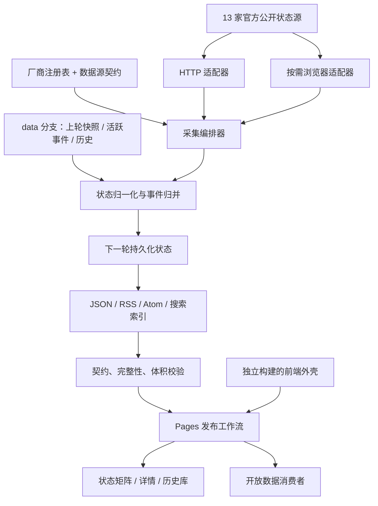

# StatusGrid 技术与产品设计

日期：2026-11-25  
状态：用户已确认设计，并要求连续完成全部代码、测试和文档；按计划的依赖顺序实施中。

## 1. 需求基线

本设计基于 [原始 PRD](../../../spec/prd.md)、[采集方案](../../../spec/status_api_check.md)、[源站清单](../../../spec/status_meta.txt) 及用户在 2026-11-25 的补充。

需求发生冲突时，以用户补充、本设计中的明确决策、原始 PRD、采集方案的顺序处理。接口事实以可复现的采集证据为准。

| 项目 | 本次设计决策 |
| --- | --- |
| 使用对象 | 用户本人及同类资深 SRE、架构师 |
| 产品目标 | 快速查看上游公开状态、下钻影响范围、直达官方说明、回溯事件、消费开放数据 |
| 商业范围 | 免费使用；本阶段不设计收费、账号、租户、套餐或支付 |
| 完整 MVP 覆盖 | 原始清单中的 13 家厂商 |
| 默认采集周期 | 5 分钟；配置支持 10 分钟 |
| 部署 | GitHub Actions 采集，GitHub Pages 发布静态页面与数据 |
| 数据边界 | 官方公开状态；不发起用户业务请求，不承诺主动拨测能力 |
| 可信原则 | 未接通、解析失败、覆盖不足和数据过期均不得显示为正常 |
| 首屏数据预算 | `summary.json` Gzip 后不超过 40 KiB；组件与地域搜索索引独立加载 |
| 完整交付定义 | 功能可用、数据来源通过验证、自动发布可运行、关键失败场景有测试和说明 |

## 2. 范围与优先级

### 2.1 MVP

1. 13 家厂商的实时矩阵、分类筛选、仅看异常、厂商排序及官方源站直跳。
2. 全局异常数、维护数、采集受阻数、快照时间、更新提示及手动重新获取已发布数据。
3. 厂商 / 子服务 / 地域 / 事件标题搜索；厂商详情抽屉与移动端详情面板。
4. 近 30 天健康轨迹及历史事件库；支持近 7 / 30 / 90 天和月度归档。
5. 原生事件与合成事件的来源、时间精度、生命周期和官方链接。
6. 全局与单厂商 JSON、月度历史、全局 / 分类 / 单厂商 RSS，以及全局 Atom。
7. 深浅主题、键盘访问、颜色之外的状态提示及减少动态效果支持。
8. 5 分钟采集、手动采集、单厂商隔离、发布校验、采集健康数据及前端失联提示。
9. URL 保存当前视图、搜索、分类、异常过滤、厂商详情及历史筛选。该能力从原 PRD 的 P1 提前，以支持应急现场分享。

阶段性交付可以先支持已验证厂商，但必须显示实际接入数量；完整 MVP 验收仍要求 13 家来源分别通过接入验收。浏览器能打开源站不等于完成接入。

### 2.2 后续增强

本地收藏、Kiosk 大屏、SVG 徽章、国际化、可选适配器故障自动建单。保留扩展点，本轮不将这些能力混入 MVP 完成标准。

### 2.3 明确的产品表达

- 正常状态文案为“官方未报告异常”，同时展示所覆盖的产品 / 地域和采集时间。
- “手动刷新”表示重新获取已发布快照，不会触发 GitHub Actions 或访问上游厂商。
- 历史数据区分“官方历史”与“本站观测”；缺失天数显示无数据。
- 统计表达为“已记录事件”“已报告影响时长”“观测覆盖度”，不将采样结果包装成供应商 SLA。

## 3. 架构选择

| 方案 | 优点 | 代价 | 结论 |
| --- | --- | --- | --- |
| Actions + 静态文件 + Pages | 沿用现有方向，运行组件少，便于独立维护与开源 | 调度和边缘缓存不提供严格实时保证 | MVP 采用 |
| 托管 Cron + 对象存储 / 边缘服务 | 更容易控制定时、缓存和数据写入 | 增加外部运行平台、凭证和维护入口 | 有实测需求后再评估 |
| 常驻采集服务 + 数据库 | 采集与查询能力灵活 | 增加进程、数据库和备份运维 | 当前不采用 |

选择静态架构时，5 分钟是目标采集间隔，不是端到端可见延迟 SLA。首先实测 GitHub Runner 与 Pages 的实际表现；页面持续显示真实数据年龄。



## 4. 工程与模块边界

单仓库、单 npm 工程，不引入多包工作区。前后端共享协议类型，采集器只在 Node.js 执行，前端只消费生成的数据。

- Node.js `>=22.12.0`；初始兼容检查使用本机 22.23.0，CI 同时验证 Node 22 / 24。
- TypeScript 严格模式；React + Vite 构建静态前端。
- 原生 `fetch` 负责 HTTP；Zod 校验配置和公共契约；XML 解析器处理订阅源，禁止执行 JSONP / 页面脚本。
- Playwright 用于确有需要的源站采集和浏览器测试；默认 HTTP 路径不依赖浏览器启动。
- Vitest 验证采集、事件和数据处理；Testing Library 验证有逻辑的交互；Playwright 验证真实浏览器行为。
- 依赖精确版本和 lockfile 在工程初始化阶段确定；不将当前文档中的版本假设直接视为已安装环境。

```text
registry/providers.json                 厂商与采集通道配置；唯一注册表
src/shared/contracts.ts                公共数据类型
src/shared/schemas.ts                  配置、快照与 API 运行时校验
src/collector/cli.ts                    参数解析与退出码
src/collector/http.ts                   请求、限流、重试、超时、编码
src/collector/browser.ts                按需浏览器生命周期与隔离上下文
src/collector/run.ts                    并发、截止时间、采集结果归并
src/collector/adapters/                 每种协议 / 厂商的独立适配器
src/collector/events/                   原生与合成事件状态机、通知里程碑
src/collector/storage/                  本地状态加载、迁移、增量归档
src/collector/export/                   静态 JSON、XML、搜索索引与发布校验
src/web/                               页面、组件、数据访问和视图状态
scripts/probe.ts                        可复现的数据源探测
scripts/release.ts                      本地构造发布目录及完整性校验
tests/fixtures/                        脱敏后的上游响应与场景数据
tests/collector/                       采集与事件测试
tests/web/                             前端逻辑测试
tests/e2e/                             浏览器用例
.github/workflows/                     校验、采集、前端构建、Pages 发布
public/                                静态资源；本地生成的 API / Feed 子目录被忽略
.statusgrid/                           本地状态与探测结果；被 Git 忽略
```

模块之间通过 [数据契约](2026-11-25-statusgrid-data-contracts.md) 交互。适配器不直接写归档、发通知或决定发布；前端不识别具体厂商的原始响应结构。

## 5. 数据源接入

接入分为四道门：HTTP 可达、结构可解析、业务语义与范围可确认、Runner 稳定性通过。每家厂商分别记录证据。

| 厂商 | 实现策略 | 关键验收 |
| --- | --- | --- |
| Cloudflare | Statuspage v2 | 核心服务分组、所有异常节点保留；正常节点折叠不丢搜索索引 |
| GitHub | Statuspage v2 | 排除说明组件；动态识别实际组件 |
| Claude | Statuspage v2 | 保留 API、网页、开发工具及云平台组件，避免固定数量假设 |
| OpenAI | Statuspage v2 兼容层 | 摘要与事件分别验证；组件 ID 作为标识，名称作为可配置展示映射 |
| Moonshot | Statuspage v2 | 使用官方域名；支持分组和重复名称 |
| DeepSeek | 独立适配器：公开 Feed + 组件快照 | Feed 历史不能单独证明实时健康；SSR 数据仅做结构解析 |
| GCP | incidents + products JSON | 活跃判定、产品映射、地域与历史时间 |
| Apple 中国 | 独立 JSON / JSONP 适配器 | 使用已纠正路径；服务列表非空；JSONP 不执行脚本 |
| Azure | RSS + 官方页面验证 | 明确公开故障覆盖范围；禁止仅按标题关键词推断已恢复 |
| AWS 中国 | 公开 JSON 优先 | UTF-8 / UTF-16LE / UTF-16BE；空列表须有接口与区域范围证据 |
| 腾讯云 | 公开业务通道优先；可选官方只读 API；浏览器兜底 | 默认不要求云账号密钥；事件、产品、地域覆盖必须同时验证 |
| 阿里云 | 公共业务接口优先；浏览器网络响应兜底 | 目录、事件接口和配置地域均成功；只拿到目录不能判绿 |
| 百度智能云 | 公共业务接口优先；浏览器兜底 | 实际响应结构、当前与历史事件关联；产品总数不写死 |

需要浏览器时，每个厂商使用独立 browser context，共享进程但不共享 Cookie；最多两个浏览器采集任务并行。识别到挑战页时返回受阻，不自动操作验证码。

首批实现中，浏览器调用的截止时间包含排队与启动。取消后先关闭对应 context，实际释放资源后才归还并发名额；采集入口最终等待共享浏览器关闭。物理回收不以定时器到期冒充成功：协议关闭永久无响应时仍可能阻塞退出，进程级终止兜底留待运行层补齐。

正常路径和失败路径均需 fixture。不能使用“等任意 JSON”“HTML 中出现正常字样”“未捕获事件响应”等弱断言宣布采集成功。

本轮已知证据和差异见 [数据源验证记录](2026-11-25-statusgrid-source-validation.md)。

## 6. 采集与新鲜度设计

| 参数 | 初始值 | 语义 |
| --- | --- | --- |
| 目标周期 | 5 分钟 | 注册表之外的全局配置；允许改为 10 |
| HTTP 并发 | 6 | 单次运行共享并发池 |
| 海外单次请求超时 | 8 秒 | 可按厂商覆盖 |
| 国内 / 跨境单次请求超时 | 15 秒 | 可按厂商覆盖 |
| 重试 | 最多 2 次 | 连接异常、408、429 和 5xx；遵守可接受范围内的 Retry-After |
| 重试退避 | 1 秒、2 秒，加小幅抖动 | 不对 404、鉴权失败、结构不兼容反复重试 |
| 单厂商总预算 | 60 秒 | 包含多接口、重试与浏览器启动 |
| 采集总预算 | 120 秒 | 未完成任务终止并标记受阻，成功厂商照常交付 |
| 页面数据检查 | 可见页面每 60 秒 | 隐藏页面暂停；恢复可见时立即检查 |
| 快照延迟提示 | 超过 2 个周期 | 5 分钟配置下为 10 分钟；10 分钟配置下为 20 分钟 |
| 全局失联 / 时间陈旧 | 超过 3 个周期 | 默认 15 分钟；10 分钟配置下为 30 分钟，替换原 60 分钟阈值 |

单厂商本轮必需数据失败时立即显示 `stale`；15 分钟阈值用于检测没有任何新快照产生的失联场景，并非允许连续失败仍保持绿灯。

以下时间分开记录：

- `generatedAt`：本轮快照生成时间。
- `lastCheckedAt`：该厂商最近尝试时间。
- `lastSuccessAt`：该厂商最近一次必需实时数据完整成功时间。
- `sourceUpdatedAt`：官方数据自带更新时间，可为 `null`；官方长时间无变更不代表采集陈旧。

状态分两轴：`reportedStatus` 表示最近可信的服务状态；`freshness` 表示数据是否可信且及时。对外兼容原 PRD 六态：数据不可信时 `status=stale`，同时保留最后可信状态和错误原因。细节见数据契约。

## 7. 历史与统计

1. 上游事件按厂商 + 上游 ID 关联；每次重新打开使用独立 episode 和生命周期事件 ID，保留之前的完整起止区间。不同通道看到同一 episode 时归并。
2. 仅对缺少结构化事件的异常生成合成事件；组件标识和地域参与归并键。
3. 抓取失败、源站空白、覆盖不完整不产生服务故障，也不关闭已有服务事件。
4. 合成事件仅在完整成功的正常观测后恢复；起止时间明确标为观测时间。
5. 原生事件恢复优先采用上游明确状态；“事件从有限列表消失”不直接推断恢复。
6. 活跃事件独立保存，不因 30 / 90 天窗口或跨月而被淘汰。
7. 月度归档按开始时间的 UTC 月份分片。迟到更新、恢复和复盘可以回写旧月份；取消原文档的“跨月永久冻结”假设。
8. 日统计以 UTC 日界线计算，界面单条时间默认按浏览器时区展示并可查看 UTC。
9. 影响时长按事件区间求并集，不累加重叠事件；维护与建议类事件单列。
10. 官方明确起止时长与本站观测时长分别统计；开放事件不参与已恢复事件的平均恢复时间。
11. 热力条显示缺失 / 不完整覆盖。开始运行前的日期保持无数据，不自动补绿。
12. 不从有限事件 Feed 推导完整 90 天历史或可用率；回填范围与观测覆盖范围分别披露。

## 8. 前端交互

整体沿用暗色工业仪表盘方向，强调信息密度、低干扰和异常辨识。状态除颜色外还必须有图标和文字；严重异常动画服从 `prefers-reduced-motion`。

### 8.1 实时矩阵

- 顶部：品牌、Live Grid / Incident Vault、开放数据、主题和源码入口。
- 态势区：已接入 / 总厂商数、异常厂商数、活跃故障数、维护数、采集受阻数及快照时间。
- 搜索区：`/` 聚焦，`Esc` 退出；分类为 AI、国内云、全球云、基础设施四类。
- 故障区：按严重度、最近事件时间、配置顺序稳定排序。受阻项单独突出，避免与服务宕机混淆。
- 正常矩阵：正常项按配置顺序排列；卡片直跳不触发详情抽屉。
- 厂商卡片：当前结论、时间、30 天轨迹、受影响组件 / 地域摘要、官方入口。
- 详情：组件树、活跃事件、事件更新、历史、覆盖范围与数据来源、专属 JSON / RSS。

PC 使用右侧详情抽屉，移动端使用可滚动详情面板。模态层需要焦点管理、Esc 关闭、关闭后恢复焦点及背景滚动约束。

### 8.2 搜索与 URL

首页摘要只承载展示必需字段。完整组件 / 地域 / 别名与事件关键词进入独立搜索索引，空闲时预加载，首次输入时保证加载。

索引未就绪时显示加载提示，不能把尚未加载的数据当作“无结果”。索引失败时可保留厂商名搜索，并明确提示搜索范围。

URL 参数：

```text
view=grid|incidents
cat=ai|cloud-cn|cloud-global|infra
q=<搜索词>
only_abnormal=1
provider=<厂商 ID>
range=7d|30d|90d|month
month=YYYY-MM
severity=degraded,partial_outage,major_outage
providers=openai,claude
```

搜索输入使用去抖 `replaceState`；视图切换和详情打开使用 `pushState`，前进后退必须恢复现场。非法参数回退安全默认值，保留合法参数。

### 8.3 历史事件库

筛选时间、厂商、严重度，按日分组；区分故障 / 维护 / 建议及官方 / 观测来源。支持展开更新和官方复盘直跳。归档按需加载，活跃事件跨月仍可见，重复分片事件只展示一次。

### 8.4 故障体验

无初始数据、请求失败、索引失败、详情失败、数据过期和零筛选结果分别设计。已有可信快照可继续显示，但必须标记数据年龄；没有数据时不构造 13 个正常卡片。

## 9. API 与发布一致性

保留原 PRD 的公共路径，增加清晰的快照版本：

- `/api/v1/summary.json`
- `/api/v1/providers/{id}.json`
- `/api/v1/incidents/recent.json`
- `/api/v1/incidents/archive/index.json`
- `/api/v1/incidents/archive/{YYYY-MM}.json`
- `/api/v1/meta/health.json`
- `/api/v1/search.json`
- `/api/v1/manifest.json`
- `/feed/all.xml`、`/feed/atom.xml`、`/feed/category/{cat}.xml`、`/feed/provider/{id}.xml`

所有热数据文件携带 `snapshotId`。前端通过 manifest 指向的版本化热数据路径加载同一轮结果；固定 API 路径保留供外部消费。

版本化目录为 `/api/v1/snapshots/{snapshotId}/`，保存摘要、详情、近期事件、健康数据和搜索索引。保留最近 60 分钟内的全部成功发布版本，且至少保留最近 12 个版本；旧版本 404 时前端刷新 manifest 一次再重试，仍失败则显示明确错误。

历史冷分片采用独立 `revision` 和不可变路径 `/api/v1/incidents/archive/{YYYY-MM}/{revision}.json`；归档索引同样使用不可变路径 `/api/v1/incidents/archive/indexes/{revision}.json`，由 manifest 引用。固定月度和索引路径保留为最新版本别名。读取后必须核对 revision，不能把同一轮详情和不同轮摘要无提示拼接。

保留所有仍被上述热快照引用的归档索引及月份版本，并额外保留每个月最近两个版本。清理按引用关系进行；旧客户端 404 时刷新 manifest / 索引一次重新定位，仍失败则显示错误，不静默混合版本。

RSS 条目标识按“事件 + 生命周期里程碑”稳定生成，严重度升级可生成新条目；普通调查文案更新不刷屏。XML 输出必须转义，前端不直接渲染上游 HTML。

GitHub Pages 的缓存头、查询参数是否影响缓存、Date 响应头和 CORS 以目标域名发布实测为准。实现不得假定固定 10 分钟 TTL 或保证查询参数一定绕过 CDN。

## 10. 存储与部署

### 10.1 分支职责

| 分支 | 内容 | 更新者 |
| --- | --- | --- |
| `main` | 源码、注册表、契约、测试、文档、工作流 | 开发工作 |
| `data` | 最新可信状态、活跃事件、日统计、月度历史、通知里程碑 | 采集工作流 |
| `gh-pages` | 已发布前端外壳与静态数据的最新完整发布目录 | 统一发布流程 |

`data` 和 `gh-pages` 可沿用单快照提交策略，但这仅减少提交历史增长，不能承诺业务归档或远端 Git 对象永不增长。推送使用读取时记录的 SHA 做 `force-with-lease`，冲突时停止，不能覆盖未知远端变更。

持久状态按日生成备份 Artifact，保留 30 天。空数据目录、首次初始化和既有状态损坏分别处理；损坏状态不得当成首次启动后覆盖。

### 10.2 工作流

1. `ci.yml`：PR / push 校验类型、静态检查、单元与浏览器测试、生产构建及产物检查。
2. `frontend.yml`：仅前端、公共协议或构建配置变化时构建外壳，再与最新持久状态生成的数据合并发布。首次安装可发布明确的无数据界面。
3. `sync.yml`：每小时第 2、7、12……57 分钟触发；支持手动触发和单厂商诊断运行。
4. `pages.yml`：可复用发布工作流，构造完整目录、更新 `gh-pages` 快照、上传 Pages Artifact、显式调用 Pages 部署 Action。

所有会修改状态或发布站点的生产入口工作流，共享仓库级 `statusgrid-release` 并发组，使用 `cancel-in-progress: false` 和 `queue: max`；锁定后再读取分支最新状态。可复用 `pages.yml` 不重复获取同一个锁，防止调用方等待持锁子任务而死锁。单厂商诊断默认不写状态、不发布。

积压的定时采集取得锁后，如果距离上一轮完整运行结束不足半个目标周期，直接记录“已有更新，跳过本轮”，不重复采集或计入接入成功轮数。前端构建任务发布前核对前端输入指纹与当前 main 的对应指纹；只有前端输入确实过时才放弃发布，由更新的前端任务完成发布。后续仅改文档的提交不能导致有效前端更新被丢弃。队列已满或平台未执行的任务，依靠下一轮采集、状态年龄和手动运行恢复，不承诺严格调度。

前端输入指纹覆盖 `src/web/**`、`src/shared/**`、`index.html`、受 Git 管理的 `public/**`、`package.json` / lockfile、TypeScript / Vite 构建配置及构建工作流；计算包含路径和文件内容，文件集合必须与前端触发规则一致。发布记录同时保存源码 SHA 和输入指纹，二者用途分开。

状态先在本地 staging 目录完成解析、归并、导出与校验，成功后才写 `data`。厂商业务采集失败属于有效的 `stale` 结果；契约损坏、存储错误或无法构造完整目录属于发布失败。

`data` 写入后 Pages 失败时，保留可重试状态和本轮通知账本；重新发布不能重复生成事件或通知。不得假定两个远端分支和 Pages 部署构成一个事务。

采用官方 Pages Artifact 部署流程；不能仅依赖 `GITHUB_TOKEN` 推送触发 Pages 构建。前端外壳从持久发布目录复用，不依赖可能过期的构建 Artifact。

### 10.3 权限与运行前提

代码阶段生成工作流和部署说明；实际上线仍需仓库 Actions / Pages 权限、目标分支策略、Pages 设置及域名 DNS 可用。

默认只访问公开数据。腾讯云只读密钥作为可选增强，不作为本地开发和默认运行前提。CI 日志不输出凭证、Cookie、完整请求头或云账号数据。

## 11. 验收与可观测性

### 11.1 数据接入验收

每家厂商均需要：

- 当前公开接口和采样日期、响应类型、有效字段、正常 / 异常 / 错误 fixture。
- 状态、事件生命周期、组件与地域覆盖的独立验证。
- 在目标 Runner 上连续至少 12 次定时采集的必需实时请求完整成功，跨度至少 55 分钟；真实上游服务故障只要被正确采到，仍算采集成功。受阻、跳过和手动运行不计入连续成功轮数；错误路径另行注入验证。
- 每种失败路径准确进入受阻状态，且其他厂商结果正常发布。

真实故障样本可使用官方历史响应；本地注入场景必须明确标记测试来源。没有真实严重故障时，不通过制造上游请求负载获取样本。

### 11.2 工程验收

- 超时、乱码、HTML 挑战页、结构变更、未知状态枚举、空列表和地域缺失均有行为测试。
- 数据库为空时、故障跨月时、采集中断时、原生 / 合成事件重叠时、历史修订时有回归测试。
- 连续运行相同输入不会重复事件、统计和 Feed 里程碑。
- 桌面及移动端核心操作、深链、前进后退、键盘与错误状态通过浏览器测试。
- 本地可重复构建；摘要 Gzip 预算自动检查；资源体积、桌面和移动端性能有记录。
- 原 PRD 的 LCP <1 秒作为受控环境优化目标；记录设备、网络、冷 / 热缓存和样本，不能以单次本机结果承诺全球性能。
- 5 分钟采集目标与实际源更新时间、任务启动延迟、页面可见延迟分别记录。

`health.json` 至少输出运行 ID、采集耗时、厂商成功 / 部分失败 / 失败、连续失败次数、最后成功时间、来源类型、协议版本及最近发布版本。外部告警自动化后续增强不影响这些基础数据的交付。

## 12. 开发入口与评审点

开发顺序见 [开发计划](../plans/2026-11-25-statusgrid-implementation.md)。

编码前重点评审：

1. 5 分钟采集、按 2 / 3 个周期计算的提示阈值和静态部署的适用边界。
2. 13 家完整 MVP 范围，以及复杂来源独立验收的要求。
3. 报告状态与采集状态分离、观测事件与官方事件区分。
4. 三分支与显式 Pages 发布、跨版本读取校验。
5. URL 同步提前、收藏 / 大屏等增强延后。

以上决策均已给出默认方案，不以未决选型阻塞计划编制。设计评审通过后，先实现工程契约与采集闭环，再开始完整界面。

## 13. 独立读者审阅后的修订

2026-11-25 的文档审阅识别并修正了以下边界：

- 将最小生产采集编排和 CLI 提前到首批编码，确保五家通用来源可真实运行，而不是只交付解析函数。
- 将上游实体与事件 episode 分开，避免故障重新打开时覆盖原有历史或误计恢复期。
- 归档和索引采用不可变版本路径，补齐 CDN 旧版本读取与保留规则。
- 为两个写入入口补充排队、单锁、积压跳过和过时前端任务处理，避免遗漏发布。
- 接入稳定性要求明确为连续完整实时采集成功，不能把连续受阻误算为稳定接入。
